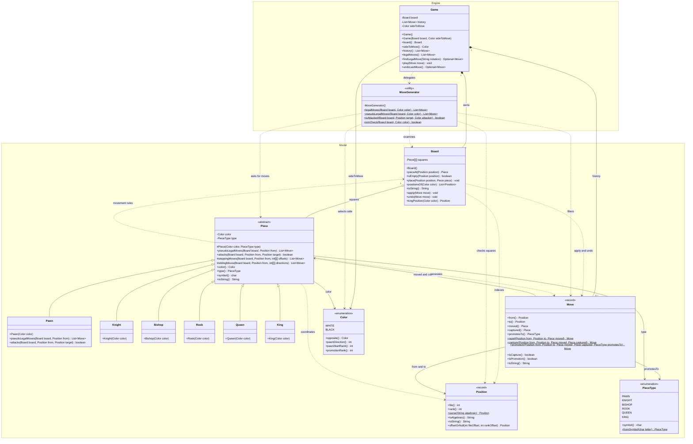
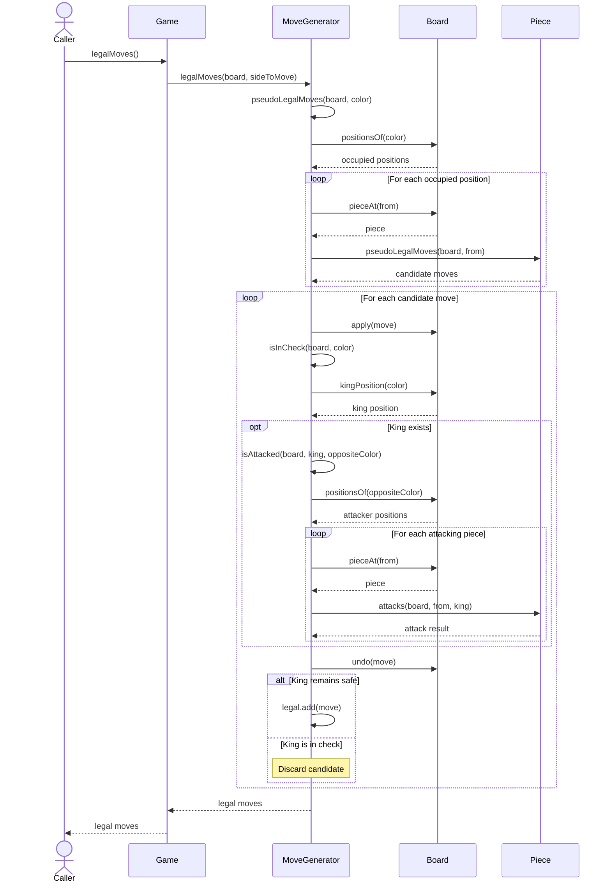

# CSC 413 — M5 Chess Engine Design

This document describes the engine and model architecture
after Milestone M5.

## 1. Class Diagram

The class diagram will describe the classes, public methods,
inheritance relationships, composition, and dependencies
in the engine and model packages.

## 2. Sequence Diagram — Game.legalMoves()

The following sequence shows how Game requests legal moves
and how MoveGenerator filters moves that would leave the
current player's king in check.

## 3. Design Decisions

- Game owns the board, move history, and side to move.
- MoveGenerator is stateless and uses static methods.
- Each Piece subclass determines its own movement rules.
- Board manages piece placement and move application.
- Legal-move filtering temporarily applies each candidate,
  checks king safety, and restores the board using undo.
- The model and engine remain independent of presentation code.
